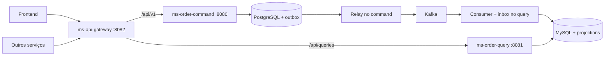

# Especificação: API Gateway com Spring Boot

**Status:** aprovado pelo usuário; primeira entrega implementada e validada por testes HTTP e smoke CQRS integrado.

**Data:** 24/11/2026.

**Aplicação proposta:** `ms-api-gateway`.

**Objetivo:** oferecer ao frontend e a outros serviços uma única origem HTTP para todos os endpoints de comando, consulta e manutenção existentes, preservando os contratos e a separação CQRS.

## 1. Base da especificação

Foram considerados os três documentos em `.docs`, os READMEs, os `pom.xml`, as configurações, os controllers, DTOs, serviços de negócio/consulta e os fluxos de outbox, rebuild e inbox das aplicações.

| Evidência no repositório | Consequência para o gateway |
| --- | --- |
| [Catálogo de projections](cqrs-projections-spec.md) | Consultas orientadas às telas, com consistência eventual |
| [Outbox e relay](cqrs-projections-outbox-proposal.md) | Escrita e snapshots são transacionais no command; publicação ocorre depois |
| [Inbox do query](cqrs-query-inbox-proposal.md) | Materialização e deduplicação permanecem no query |
| [Command](../ms-order-command/README.md) e seu `src/main/java/com/cqrs/ordercommand/interfaces/rest` | 21 operações HTTP de negócio/manutenção sob `/api/v1` |
| [Query](../ms-order-query/README.md) e seu `src/main/java/com/cqrs/orderquery/interfaces/rest` | Sete operações GET sob `/api/queries` |
| `application.yaml` e `pom.xml` das duas aplicações | Java 21, Spring Boot 4.2.0, portas 8080 e 8081; Actuator e springdoc existentes |
| [Compose](../compose.yaml) | Sobe infraestrutura Kafka/PostgreSQL/MySQL; ainda não sobe as aplicações |

O código atual prevalece sobre exemplos de evolução dos documentos: somente `CREATED` e `CANCELLED` são aceitos nas consultas de pedidos. `SALES_DASHBOARD` está reservado e não possui endpoint implementado. Autenticação e autorização ainda não existem nas aplicações.

## 2. Decisão arquitetural

Criar uma aplicação Spring Boot independente, com Spring Cloud Gateway Server WebFlux e Reactor Netty, na porta local **8082**. Ela funcionará como proxy HTTP com rotas explícitas, políticas de acesso, CORS, tratamento de falhas de transporte e observabilidade.



O gateway concentra o **acesso** aos endpoints. Regras de negócio, validação de DTOs, transações, cálculos de projections e persistência permanecem nos serviços. Ele não acessará bancos ou Kafka, não copiará controllers e não importará os JARs das aplicações. Não haverá orquestração de comandos nem composição de respostas nesta etapa.

WebFlux no gateway é compatível com os serviços MVC existentes: a integração entre eles é HTTP. O gateway será empacotado como JAR e não incluirá o starter MVC. Essa escolha segue o [starter e runtime oficiais do Gateway Server WebFlux](https://docs.spring.io/spring-cloud-gateway/reference/spring-cloud-gateway-server-webflux/starter.html).

### 2.1 Versões e dependências

- Java 21 e Maven Wrapper, seguindo o repositório.
- Spring Boot e Spring Cloud com versões compatíveis e fixadas no `pom.xml`; importar `spring-cloud-dependencies` como BOM.
- Dependências: `spring-cloud-starter-gateway-server-webflux`, Actuator, registro Prometheus, Spring Security/OAuth2 Resource Server com suporte JWT e springdoc para WebFlux. Dependências de testes incluirão suporte WebFlux, Spring Security Test e servidor HTTP simulado.
- Não adicionar JPA, Flyway, drivers JDBC, Kafka, MapStruct ou Redis nesta entrega.

Os serviços atuais usam Boot 4.2.0. Na consulta à [matriz oficial do Spring Cloud](https://spring.io/projects/spring-cloud/), a linha 2025.1.x declara Boot 4.0.x e 4.1.x, com suporte a 4.1.x a partir de 2025.1.2; ela não confirma 4.2.x. Portanto, não presumir essa combinação. A base proposta para o gateway é Boot 4.1.x + Cloud 2025.1.x, a partir de 2025.1.2, com patches fixados e verificados na implementação. Usar Boot 4.2.x somente se houver uma release train explicitamente compatível. O gateway pode ter versão Boot diferente dos backends sem alterar seus contratos HTTP.

## 3. Contrato externo e roteamento

Base local única: `http://localhost:8082`. Preservar integralmente os caminhos existentes, sem `StripPrefix`, aliases ou reescrita de versões:

| Caminho no gateway | Destino | Reescrita |
| --- | --- | --- |
| `/api/v1/...`, conforme catálogo abaixo | `COMMAND_SERVICE_URL` | Nenhuma |
| `/api/queries/...`, conforme catálogo abaixo | `QUERY_SERVICE_URL` | Nenhuma |

Não adotar a regra genérica “GET vai para query”. O command também oferece GETs com contratos próprios e dados necessários à edição, como `sku`, `active`, `notes`, `version` e IDs dos itens. Esses GETs continuarão acessíveis pelo gateway. As projections não contêm todos esses campos.

### 3.1 Catálogo completo do command

Todos os caminhos desta tabela são iguais no gateway e no `ms-order-command`. Cada método listado representa uma operação existente.

| Caminho | Métodos | Finalidade |
| --- | --- | --- |
| `/api/v1/customers` | POST, GET | Criar e listar clientes no modelo de escrita |
| `/api/v1/customers/{id}` | GET, PUT, DELETE | Consultar, editar e excluir cliente sem pedidos |
| `/api/v1/products` | POST, GET | Criar e listar produtos no modelo de escrita |
| `/api/v1/products/{id}` | GET, PUT, DELETE | Consultar, editar e excluir produto sem itens vinculados |
| `/api/v1/orders` | POST, GET | Criar e listar pedidos no modelo de escrita |
| `/api/v1/orders/{id}` | GET | Consultar pedido transacional |
| `/api/v1/orders/{id}/cancel` | POST | Cancelar pedido |
| `/api/v1/orders/{orderId}/items` | GET, PUT | Listar ou substituir todos os itens do pedido |
| `/api/v1/orders/{orderId}/items/{itemId}` | GET | Consultar item de um pedido |
| `/api/v1/order-outbox` | GET | Listar eventos; acesso operacional |
| `/api/v1/order-outbox/{id}` | GET | Consultar evento e payload; acesso operacional |
| `/api/v1/order-outbox/{id}/retry` | POST | Reenfileirar evento em ERRO; acesso operacional |
| `/api/v1/projections/rebuild` | POST | Gerar página de snapshots; acesso operacional |

Preservar filtros de clientes/produtos (`q`, `page`, `size`), de pedidos (`customerId`, `status`, `page`, `size`) e da outbox (`orderId`, `status`, `eventType`, `projectionKey`, `page`, `size`).

Rebuild continua aceitando `resourceType=CUSTOMER|PRODUCT`, `after` e `size`, retornando `resourceType`, `processed`, `nextCursor` e `hasMore`. O caller controla a paginação. O gateway não iniciará as próximas páginas nem repetirá uma página automaticamente. Um rebuild de clientes também contempla seus pedidos; não criar um `resourceType=ORDER` inexistente.

### 3.2 Catálogo completo do query

Todos os caminhos desta tabela são iguais no gateway e no `ms-order-query`.

| Método | Caminho | Parâmetros específicos |
| --- | --- | --- |
| GET | `/api/queries/customers` | `search`, `sort` |
| GET | `/api/queries/customers/{customerId}` | UUID no caminho |
| GET | `/api/queries/products` | `search`, `category`, `available`, `minPrice`, `maxPrice`, `sort` |
| GET | `/api/queries/products/{productId}` | UUID no caminho |
| GET | `/api/queries/orders` | `customerId`, `status`, `from`, `to`, `sort` |
| GET | `/api/queries/orders/{orderId}` | UUID no caminho |
| GET | `/api/queries/customers/{customerId}/orders` | `sort` |

Listagens preservam `page` a partir de zero, `size` de 1 a 100, padrão 20, e resposta com `content`, `page`, `size`, `totalElements` e `totalPages`. Manter ordenações permitidas pelos query services e datas `from <= createdAt < to`. O gateway encaminha inclusive parâmetros repetidos e codificados; não converte `q` em `search`, não reordena resultados e não replica validações de domínio.

Não criar rota para `/api/queries/dashboard/sales` nesta entrega.

### 3.3 Allowlist e métodos

Implementar as combinações de caminho e método das duas tabelas como allowlist. Não publicar `/api/**`, `/api/v1/**` ou `/api/queries/**` irrestritos: isso exporia endpoints futuros sem revisão de acesso.

Aplicar regras de segurança operacionais antes das regras gerais. Caminho desconhecido retorna `404`; método não permitido em caminho conhecido retorna `405` com `Allow`. Como um predicado `Method` sem correspondência pode resultar apenas em ausência de rota, prever tratamento explícito de método para garantir esse contrato. `OPTIONS` de preflight é tratado no gateway. `HEAD` não integra o contrato inicial e recebe `405` nos caminhos de negócio conhecidos.

Validar formatos e conflitos de caminhos sem exigir UUID válido no predicado de rota: UUID inválido em uma operação conhecida deve continuar chegando ao backend e resultar em `400`, como hoje.

## 4. Transparência HTTP

Encaminhar método, caminho, query string e corpo sem remodelar DTOs. Preservar status, conteúdo e headers de aplicação, incluindo `Content-Type`, `Location`, `Allow`, `WWW-Authenticate` e `Retry-After`, respeitando as regras HTTP para headers hop-by-hop.

Criações continuam retornando `201` com corpo; atualizações e cancelamento, `200`; exclusões, `204`; retry de outbox, `202`; rebuild, `200`. O `202` da outbox confirma reenfileiramento, não atualização concluída no MySQL. Não transformar comandos síncronos em `202` genérico.

Hoje os controllers de criação retornam `Location` relativo, como `/api/v1/orders/{id}`. Como os caminhos são preservados, o cliente resolve esse endereço na origem do gateway. Se futuramente houver `Location` absoluto apontando para host interno, normalizar somente a origem para a URL pública configurada e testar o comportamento. Não redirecionar o `Location` do command para uma projection com outro contrato.

As respostas do command e do query continuam diferentes. Por exemplo, produto no command usa `id` e `unitPrice`; catálogo no query usa `productId` e `price`. Não introduzir envelope comum de sucesso nem converter esses campos no gateway.

## 5. Consistência eventual e uso pelo frontend

O fluxo PostgreSQL → outbox → Kafka → inbox → MySQL permanece assíncrono. O gateway não aguarda o consumer nem garante leitura imediata da escrita pelas projections.

Fluxo recomendado:

1. Criar/alterar pelo `/api/v1` e usar o corpo confirmado pelo command para o retorno imediato da ação.
2. Consultar telas e listagens pelo `/api/queries`.
3. Após uma escrita, atualizar a consulta com polling limitado, por exemplo até cinco tentativas com espera de um segundo. Comparar o estado esperado quando os campos estiverem disponíveis; um `200` isolado pode conter snapshot antigo.
4. Caso não haja convergência nesse intervalo, exibir “atualização em processamento” e permitir nova consulta. Esse prazo de interface não é SLA de atualização das projections.
5. Tratar `404` logo após criação como possível atraso no contexto daquela ação; um `404` isolado não prova que existe atualização pendente.

Sem fallback automático ao command, sem misturar respostas de origens diferentes e sem cache de respostas de negócio nesta etapa. Resumo e detalhe podem refletir revisões diferentes. As versões técnicas das projections não fazem parte dos DTOs públicos atuais; não prometer um token de consistência ou `read-your-writes` sem evolução dos contratos dos serviços.

Para telas de edição que precisam de campos ausentes nas projections, utilizar explicitamente o GET correspondente do command, com permissão própria.

## 6. Segurança e CORS

### 6.1 Perfis e permissões propostas

O perfil `local` pode executar sem provedor de identidade, vinculado a loopback e com manutenção desabilitada por padrão. Habilitar manutenção local exige configuração explícita. Testes desse perfil não comprovam segurança de produção.

O perfil `prod` deve exigir JWT Bearer válido, verificar assinatura, expiração, emissor e audiência e negar acesso sem configuração de identidade. Usar `SecurityWebFilterChain` reativa e Resource Server, conforme [documentação do Spring Security](https://docs.spring.io/spring-security/reference/reactive/oauth2/resource-server/jwt.html). A audiência precisa de validação configurada; não presumir que `issuer-uri` a valida automaticamente.

| Grupo | Permissão proposta |
| --- | --- |
| Sete consultas de projections | `cqrs.read` |
| GETs de negócio no command | `cqrs.command.read` |
| POST/PUT/DELETE de negócio no command | `cqrs.write` |
| Consulta de outbox | `cqrs.ops.read` |
| Retry de outbox e rebuild | `cqrs.ops.write` |
| Swagger e documentos OpenAPI em produção | `cqrs.docs` |

Permissões operacionais não são concedidas implicitamente por `cqrs.read` ou `cqrs.write`. Manutenção é desabilitada por padrão em qualquer perfil até habilitação explícita; quando habilitada em produção, exige a permissão operacional correspondente. Nenhuma rota operacional ficará acessível por uma regra ampla de negócio.

Frontend usa o fluxo de autenticação do provedor a definir; serviços usam credenciais próprias, como client credentials, com scopes mínimos. O gateway valida e encaminha o Bearer recebido, sem implementar login, emitir tokens ou persistir sessões. CSRF pode ser desabilitado para essa API stateless com Bearer em header; autenticação por cookie exigirá revisão dessa decisão.

Scopes não implementam autorização por proprietário. Os serviços ainda não vinculam identidade autenticada a `customerId`; a primeira exposição em produção deve ser restrita a operadores e serviços confiáveis com acesso global. Acesso de clientes finais aos próprios pedidos exige autorização por recurso nos backends e testes contra acesso a outro cliente, incluindo endpoints de listagem. Filtrar somente por um `customerId` fornecido pelo caller não resolve essa lacuna.

Em produção, restringir rede/ingress dos backends aos callers autorizados e impedir bypass público do gateway. Se houver chamadas internas diretas, os backends também devem validar identidade e aplicar autorização. O gateway não resolve sozinho a ausência de segurança dos serviços.

### 6.2 CORS e headers de confiança

- Configurar origens permitidas por ambiente; padrão local proposto `http://localhost:4200` e `http://localhost:5173`.
- Permitir `GET`, `POST`, `PUT`, `DELETE` e `OPTIONS`; aceitar `Authorization`, `Content-Type`, `X-Correlation-Id`, `traceparent` e `tracestate`.
- Expor `Location`, `X-Correlation-Id` e `Retry-After` ao navegador. Não habilitar cookies/credenciais CORS nesta API Bearer.
- Responder preflight permitido sem JWT e sem chamar o backend; origem não permitida não recebe autorização CORS. Configurar o handler para preflight mesmo sem correspondência de método da rota, conforme [CORS no Gateway](https://docs.spring.io/spring-cloud-gateway/reference/spring-cloud-gateway-server-webflux/cors-configuration.html).
- Centralizar CORS no gateway e evitar headers duplicados dos backends.
- Remover headers de identidade fornecidos pelo cliente, como `X-User-Id` e `X-Roles`; não usá-los como credenciais.
- Aceitar `Forwarded`/`X-Forwarded-*` somente de proxies confiáveis configurados. Em acesso direto, descartar valores recebidos e gerar informações coerentes com a requisição. A origem pública será configuração confiável, não derivada de um header arbitrário.

## 7. Falhas, limites e repetição de requisições

### 7.1 Política inicial

| Configuração | Valor inicial proposto |
| --- | --- |
| Timeout de conexão ao backend | 2 segundos |
| Timeout de resposta das consultas e GETs do command | 5 segundos |
| Timeout de resposta de comandos de negócio | 15 segundos |
| Timeout de resposta do rebuild | 60 segundos |
| Corpo máximo da requisição | 1 MiB |
| Retry automático no gateway | Desabilitado para todos os métodos |
| Cache de negócio | Desabilitado |

Valores são parâmetros operacionais iniciais, sujeitos a medição. Implementar timeouts por rota e manter os do proxy externo acima dos prazos correspondentes, conforme [configuração oficial de timeouts](https://docs.spring.io/spring-cloud-gateway/reference/spring-cloud-gateway-server-webflux/http-timeouts-configuration.html). Esses limites não são promessa de duração máxima de uma transação no backend; desconectar o cliente pode não cancelar o processamento.

Não configurar `Retry` como filtro global. O command não oferece idempotência HTTP por chave; repetição automática pode criar pedidos duplicados e rebuild repetido gera novas revisões. A deduplicação da inbox e a idempotência do producer Kafka não tornam o POST HTTP idempotente. Preservar um header `Idempotency-Key`, se recebido, não significará suporte funcional a ele. A evolução de retry deve seguir a [semântica do filtro Retry](https://docs.spring.io/spring-cloud-gateway/reference/spring-cloud-gateway-server-webflux/gatewayfilter-factories/retry-factory.html) e um contrato explícito dos serviços.

Aplicar limite de corpo antes do encaminhamento, inclusive com transferência chunked e sem `Content-Length`, sem carregar corpos ilimitados na memória. O limite deve comportar os pedidos com até 1000 itens já aceitos pelo DTO. Não introduzir rate limiting distribuído ou circuit breaker nesta entrega; avaliar depois com dados de carga e sem respostas de sucesso artificiais.

### 7.2 Contrato de erro

Preservar os Problem Details e status emitidos pelos backends, inclusive `400`, `404`, `405`, `409` e `500`. Erros gerados pelo próprio gateway usarão `application/problem+json`, com `type`, `title`, `status`, `detail`, `instance` e `correlationId`.

| Situação no gateway | Status |
| --- | --- |
| Token ausente/inválido em rota protegida | 401 |
| Permissão insuficiente | 403 |
| Caminho desconhecido ou manutenção desabilitada | 404 |
| Método não permitido em caminho conhecido habilitado | 405 + `Allow` |
| Corpo acima do limite | 413 |
| Conexão recusada, DNS indisponível ou serviço inalcançável | 503 |
| Resposta HTTP inválida ou conexão interrompida pelo backend | 502 |
| Timeout de conexão/resposta | 504 |

Não expor URL interna, stack trace, token ou payload no erro. Para timeout/falha de transporte após enviar um comando, informar que o resultado é indeterminado e orientar conferência antes de repetir. Falha no gateway não implica rollback no backend. No rebuild, parte dos recursos da página pode ter sido confirmada, pois o serviço usa transações por recurso.

## 8. Observabilidade e operação

Gerar um UUID em `X-Correlation-Id` quando ausente; aceitar valor externo somente se for UUID válido e único no header. Devolver e encaminhar o valor normalizado, inclusive em erros locais, autenticação e `404`. Propagar contexto W3C de tracing com instrumentação Micrometer compatível com o BOM escolhido.

Registrar método, identificador da rota, status, duração, correlação e classe de falha. Usar templates de caminho nos rótulos das métricas; não usar UUIDs, query string, e-mail ou token. Não registrar corpos ou `Authorization`. Propagação do header pode ser feita desde o início, mas correlação nos logs dos backends exige instrumentá-los; ela ainda não existe apenas pela inclusão do gateway.

Expor somente health sem detalhes na superfície permitida. Disponibilizar readiness, liveness e Prometheus em porta/rede de gerenciamento restrita em produção. Não criar rotas públicas para Actuator dos serviços nem habilitar endpoints de edição dinâmica de rotas.

Readiness do gateway representa sua capacidade de receber e rotear HTTP, sem depender simultaneamente da saúde dos dois backends. Indisponibilidade do query deve continuar permitindo comandos, e vice-versa. Monitorar separadamente sucesso, erro e latência por destino e as métricas existentes do relay/inbox. Escalar o gateway horizontalmente, sem estado local necessário à correção das chamadas.

## 9. Documentação centralizada

Disponibilizar um Swagger UI no gateway com dois documentos selecionáveis: **Command API** e **Query API**. Cada serviço continua proprietário de seus DTOs e OpenAPI; não manter cópias manuais nem fundir schemas com nomes potencialmente conflitantes.

| Recurso no gateway | Origem |
| --- | --- |
| `/swagger-ui.html` e recursos da UI | springdoc WebFlux no gateway |
| `/v3/api-docs/command` | `/v3/api-docs` do command |
| `/v3/api-docs/query` | `/v3/api-docs` do query |

Um componente de documentação obtém cada JSON e substitui `servers` pela origem pública configurada, preservando os caminhos. Configurar também o esquema Bearer e os requisitos de segurança exibidos para uso pelo gateway; os documentos atuais dos backends ainda não os declaram. Se necessário, ajustar servidores em operações para impedir que sobreponham a origem pública. Esse componente altera somente documentação, não respostas de negócio.

Quando manutenção estiver desabilitada, remover suas operações do documento servido pelo gateway. Quando habilitada, indicá-las como operacionais com os scopes correspondentes. Não usar a ausência no Swagger como mecanismo de autorização.

Configurar explicitamente as URLs dos dois documentos na UI. O “Try it out” deve chamar **8082** localmente ou a origem pública HTTPS, nunca 8080/8081 ou DNS interno. Cada documento deve falhar independentemente se seu backend estiver fora do ar. Não adicionar proxy irrestrito para Swagger UI e `/v3/**` dos backends.

## 10. Configuração e organização propostas

| Variável proposta | Padrão local / regra |
| --- | --- |
| `SERVER_PORT` | `8082` |
| `COMMAND_SERVICE_URL` | `http://localhost:8080` |
| `QUERY_SERVICE_URL` | `http://localhost:8081` |
| `GATEWAY_PUBLIC_URL` | `http://localhost:8082`; HTTPS em produção |
| `GATEWAY_CORS_ALLOWED_ORIGINS` | Origens locais da seção 6 |
| `GATEWAY_MAINTENANCE_ENABLED` | `false` |
| `GATEWAY_CONNECT_TIMEOUT_MS` | `2000` |
| `GATEWAY_QUERY_TIMEOUT_MS` | `5000` |
| `GATEWAY_COMMAND_TIMEOUT_MS` | `15000` |
| `GATEWAY_REBUILD_TIMEOUT_MS` | `60000` |
| `GATEWAY_MAX_REQUEST_BYTES` | `1048576` |
| `JWT_ISSUER_URI` | Obrigatório em produção |
| `JWT_AUDIENCE` | Obrigatório em produção |

Esses nomes são contrato proposto da nova aplicação e deverão ser vinculados por configuração tipada; não são todos propriedades nativas do Spring Cloud. Validar URLs HTTP(S), timeouts positivos e configuração de produção no startup. Rotas serão estáticas e versionadas, sem discovery automático, Eureka ou Config Server nesta fase. A estrutura de propriedades nativas deve seguir [a configuração da versão escolhida do Gateway](https://docs.spring.io/spring-cloud-gateway/reference/spring-cloud-gateway-server-webflux/configuration.html).

```text
ms-api-gateway/
  pom.xml
  mvnw / mvnw.cmd / .mvn/wrapper/
  README.md
  src/main/java/com/cqrs/apigateway/
    MsApiGatewayApplication.java
    config/       # propriedades, allowlist de rotas, CORS e segurança
    filter/       # correlação, headers confiáveis e limite de corpo
    error/        # Problem Details e métodos não permitidos
    documentation/ # exposição dos dois OpenAPI na origem pública
  src/main/resources/
    application.yaml
    application-local.yaml
    application-prod.yaml
  src/test/java/com/cqrs/apigateway/
```

Não criar camadas de domínio ou repositórios vazios: a aplicação não possui domínio de negócio próprio.

Na primeira entrega, executar as três aplicações por Maven/IDE e manter o Compose atual para infraestrutura. O README novo documentará o perfil local, URLs e variáveis. Com os serviços disponíveis, a execução planejada será:

```powershell
cd ms-api-gateway
.\mvnw.cmd spring-boot:run -Dspring-boot.run.profiles=local
```

Esse comando depende da implementação futura do módulo. Em container, `localhost` aponta para o próprio gateway: usar URLs dos serviços na rede compartilhada ou `host.docker.internal` quando os backends rodarem no host com Docker Desktop. Containerizar as três aplicações e adicioná-las ao Compose será uma etapa separada. As portas dos backends permanecem disponíveis em desenvolvimento; a publicação externa em produção concentra-se no gateway.

## 11. Exemplos de integração pelo endereço único

Exemplos para o perfil local; em produção acrescentar o Bearer com os scopes adequados.

```http
POST http://localhost:8082/api/v1/customers
Content-Type: application/json

{"name":"Maria Silva","email":"maria@example.com","phone":"11999999999"}
```

```http
GET http://localhost:8082/api/queries/customers?search=Maria&page=0&size=20&sort=name,asc
```

```http
POST http://localhost:8082/api/v1/orders
Content-Type: application/json

{"customerId":"<UUID existente>","items":[{"productId":"<UUID existente>","quantity":2}],"notes":"Pedido pelo gateway"}
```

Os marcadores de UUID precisam ser substituídos pelos IDs reais de cliente e produto ativos.

```http
GET http://localhost:8082/api/queries/orders/{orderId}
```

Operação abaixo somente com manutenção habilitada e permissão operacional no perfil protegido:

```http
POST http://localhost:8082/api/v1/projections/rebuild?resourceType=CUSTOMER&size=20
```

## 12. Critérios de aceite e verificação futura

| Cenário | Resultado esperado |
| --- | --- |
| Exercitar as 28 operações catalogadas | Destino correto, caminho e método preservados |
| GET no command e GET na projection do mesmo recurso | Cada um mantém seus campos e origem, sem substituição |
| Criação pelo gateway | `201`, corpo e `Location` resolvendo na origem do gateway |
| Exclusão e retry de outbox | `204`/`202` sem corpo artificial |
| Filtros com espaços, acentos, datas, vírgulas e parâmetros repetidos | Encaminhamento fiel da query string |
| Erro de validação, conflito e ausência nos backends | Problem Details e status preservados |
| Método de escrita em `/api/queries/orders` | `405` + `Allow`, nenhuma chamada de escrita |
| Caminho não catalogado, inclusive dashboard | `404`, sem chamada ao backend |
| Manutenção desabilitada | `404`, nenhuma chamada operacional; operação ausente no OpenAPI exposto |
| JWT inválido, expirado, emissor/audiência divergentes | `401`, sem encaminhamento |
| Token válido sem scope da operação | `403`, sem encaminhamento |
| Token comum em retry/rebuild ou consulta de outbox | Negado sem a permissão operacional correspondente |
| Preflight permitido e origem não permitida | CORS correto; sem exigir token no preflight permitido |
| Header de identidade ou proxy forjado | Removido/normalizado segundo a cadeia de confiança |
| Backend indisponível, timeout e conexão interrompida | `503`, `504` e `502` conforme classificação |
| Comando cujo backend confirma e perde a resposta | Gateway faz uma única tentativa e informa resultado indeterminado |
| Corpo maior que 1 MiB, com e sem `Content-Length` | `413`, sem encaminhar corpo acima do limite |
| Falha do query com command saudável | Comandos continuam disponíveis |
| Correlação ausente ou inválida | UUID gerado, propagado e devolvido inclusive nos erros |
| Swagger “Try it out” de ambos os documentos | Chamada à origem do gateway com segurança documentada |
| Pedido criado e consultado com consumer atrasado | Resposta do comando disponível; consulta pode retornar ausente/antiga, sem fallback |

Usar `WebTestClient` com backends HTTP simulados para roteamento, segurança, CORS, documentação e falhas. Validar que erros/rejeições locais não chamam o destino e que não há repetição de comandos. Um teste de smoke integrado executará criação de cliente/produto/pedido pelo gateway e aguardará, com prazo limitado, a projection real alimentada por Kafka/MySQL. Essa etapa depende dos serviços e infraestrutura reais; não basta simular a resposta da consulta para provar o fluxo CQRS.

## 13. Sequência de implementação

1. Resolver e fixar versões compatíveis; criar módulo independente e testes dos cenários essenciais.
2. Implementar allowlist das 28 operações, propriedades, perfis e preservação HTTP.
3. Implementar limites, timeouts, erros e correlação, sem retry/cache.
4. Configurar CORS, scopes e bloqueio de manutenção; validar perfil protegido com emissor de teste.
5. Centralizar Swagger/OpenAPI e verificar origem pública, autenticação e operações operacionais.
6. Executar testes de integração do gateway e smoke do fluxo real; documentar execução.
7. Antes da exposição em produção, configurar provedor/emissor/audiência, origens HTTPS, permissões, rede dos backends e observabilidade. Acesso de clientes finais depende da autorização por recurso descrita na seção 6.

O escopo aprovado preserva aplicações de negócio, contratos HTTP, migrations, mensageria e infraestrutura existentes. Agregação de respostas/BFF, nova nomenclatura de URLs, idempotência HTTP, dashboard, rate limiting distribuído, descoberta de serviços e deployment ficam para evoluções próprias.

## 14. Implementação e validação da primeira entrega

Implementado o módulo independente [ms-api-gateway](../ms-api-gateway/README.md), com Java 21, Spring Boot **4.1.2**, Spring Cloud **2025.1.2**, Gateway Server WebFlux **5.0.2** e springdoc **3.2.1**. A verificação de compatibilidade do Spring Cloud permanece habilitada.

- `EndpointCatalog` compartilha as 28 combinações de caminho/método entre roteamento, autorização, tratamento de métodos e OpenAPI.
- Perfil local em loopback; manutenção desabilitada por padrão; demais perfis exigem configuração JWT e origem pública HTTPS. A combinação `local,prod` é rejeitada.
- JWT valida assinatura, expiração, emissor e audiência, com scopes independentes de negócio, operação e documentação.
- Corpos limitados antes do encaminhamento, incluindo chunked; timeouts por operação; retry desabilitado também no transporte Netty; Problem Details em erros locais.
- Preservação de contratos, query strings e `Location`; documentação centralizada com origem pública e remoção de operações operacionais desabilitadas.
- CORS centralizado, remoção de headers CORS dos backends, correlação, headers de proxy regenerados, métricas e dependências de tracing.
- Nenhum proxy externo é confiável nesta entrega: headers recebidos são descartados, origem vem da configuração e IP vem do peer da conexão. Suporte a cadeias confiáveis de ingress fica para configuração/evolução específica.
- No perfil `prod`, Actuator fica exclusivamente no listener de gerenciamento, em loopback por padrão. `/actuator/health` na porta pública não é publicado. O listener de gerenciamento deve permanecer restrito pela rede.

**Validação executada:** `mvn -f ms-api-gateway/pom.xml -B -ntp verify`, com **46 testes, zero falhas e zero erros**. Inclui servidores HTTP locais, as 28 operações catalogadas, JWTs RSA assinados, scopes, CORS, manutenção, Swagger, métodos, limites fixo/chunked, indisponibilidade, timeout e ausência de retry. Maven Wrapper **3.10.1** executado e validado com Java **21.0.11**.

**Smoke integrado executado:** `ms-api-gateway/scripts/smoke.ps1 -SkipBuild`, após gerar os três JARs. Containers temporários PostgreSQL 17, MySQL 8.4 e Kafka 4.1.2, sem volumes do Compose. Cliente, produto e pedido foram criados pelo gateway; o pedido de duas unidades a R$ 12,50 foi confirmado com total R$ 25,00 e depois retornou pelo query com seus itens projetados. O fluxo atravessou outbox, relay, Kafka e inbox reais. Também foram verificados os dois documentos OpenAPI com a origem do gateway. O script encerrou seus processos e removeu seus containers ao concluir.

Os comandos de execução, variáveis, procedimentos de produção e repetição do smoke estão no README do módulo. Autorização por proprietário nos backends e configuração de identidade/rede de produção continuam sob os limites da seção 6; esta implementação não os apresenta como resolvidos.
