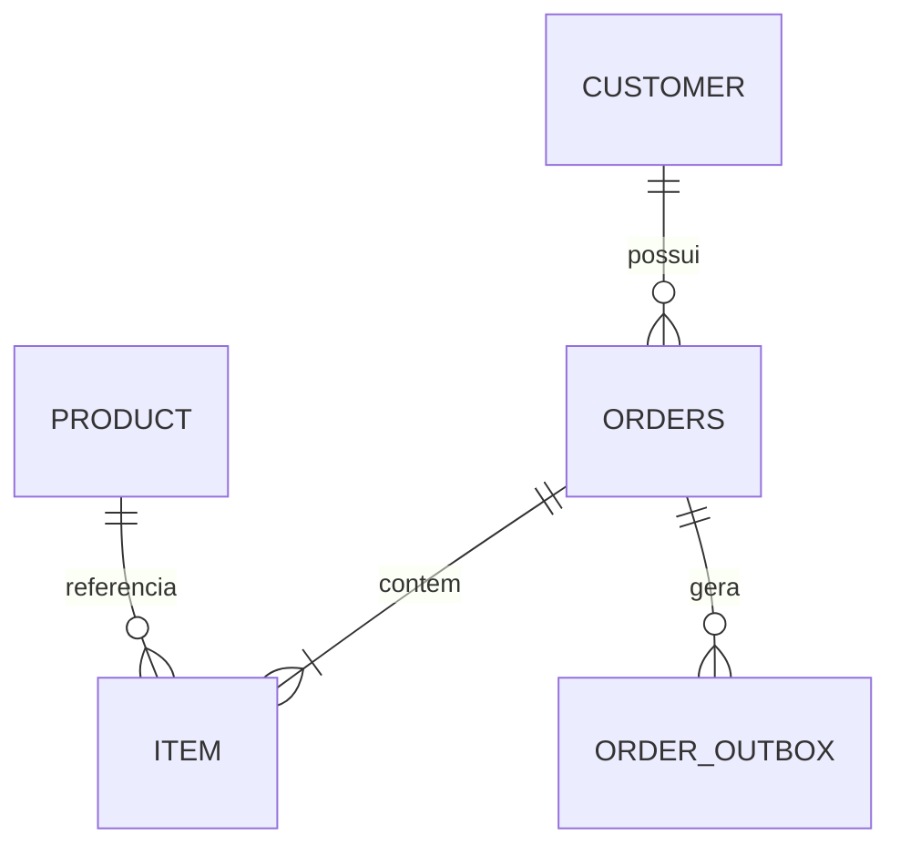

# ms-order-command

API REST de comandos de pedidos com Java 21, Spring Boot 4.2.0, PostgreSQL e Kafka.
Inclui Spring Data JPA, Bean Validation, Flyway, MapStruct 1.6.3, Swagger/OpenAPI,
Actuator, Prometheus, Maven Wrapper e testes com Testcontainers.

## Modelo de dados

As tabelas ficam no schema `order_command`. Os identificadores são UUIDs gerados pela
aplicação. Datas usam `Instant` / `TIMESTAMPTZ`; valores monetários usam `BigDecimal` /
`NUMERIC(19,2)`, sem arredondamento silencioso. Nesta versão, os preços são em BRL.

| Tabela | Campos |
| --- | --- |
| `customer` | `id`, `name` (160), `email` (254, único), `phone` (24, opcional), `active`, `created_at`, `updated_at`, `version` |
| `product` | `id`, `sku` (64, único), `name` (160), `description` (2000, opcional), `unit_price`, `active`, `created_at`, `updated_at`, `version` |
| `orders` | `id`, `customer_id`, `status` (`CREATED`, `CANCELLED`), `total_amount`, `notes` (1000, opcional), `created_at`, `updated_at`, `version` |
| `item` | `id`, `order_id`, `product_id`, `product_sku`, `product_name`, `quantity`, `unit_price` |
| `order_outbox` | `id`, `order_id` (opcional), `data_criacao`, `data_envio`, `status`, `event_type`, `payload` JSONB, `operation`, `projection_key`, `projection_version`, `schema_version`, `attempt_count`, `next_attempt_at`, `last_error` |
| `projection_revision` | `event_type`, `projection_key`, `version`; revisão crescente por tipo/chave |
| `order_outbox_legacy` | Arquivo preservado dos eventos anteriores à migration V3, sem payload de projection |



`orders` evita a palavra reservada SQL `ORDER`. Cada pedido pertence a exatamente um
cliente e cada item pertence a exatamente um pedido e um produto. Não há exclusão em
cascata de histórico. Clientes/produtos referenciados não podem ser excluídos; podem
ser desativados. Pedidos são cancelados, preservando itens e histórico.

E-mails são normalizados para minúsculas e SKUs para maiúsculas antes de persistir.
Um cliente pode existir sem pedidos. Somente clientes/produtos ativos podem participar
de novos pedidos. O preço é positivo, com até duas casas decimais e máximo de
999999999.99. Cada item tem quantidade entre 1 e 10000; pedidos têm entre 1 e 1000
itens, sem produto repetido: consolide a quantidade na mesma linha.

O servidor calcula subtotais e total; o cliente envia somente produto e quantidade.
Nome, SKU e preço são copiados para o item, preservando o pedido quando o catálogo
muda. Substituir os itens cria novas linhas com os preços atuais do catálogo.
Pedidos cancelados não aceitam alteração nem novo cancelamento. O campo `version`
usa optimistic locking para detectar alterações concorrentes durante a transação.

## Migrations

- `V1__create_order_tables.sql`: tabelas, chaves estrangeiras, unicidade, checks e índices.
- `V2__enforce_order_item_invariants.sql`: valida, no commit, que cada pedido tem
  1..1000 itens e que seu total corresponde à soma dos itens. A validação é adiada
  para permitir criar o pedido e seus itens na mesma transação.
- `V3__projection_outbox.sql`: preserva a outbox anterior como `order_outbox_legacy`,
  cria a outbox de projections com campos obrigatórios e o controle de revisões.
- `V4__outbox_relay_retries.sql`: tentativas, agendamento de retry, erro resumido e
  índices para o relay. Não altera os payloads ou o arquivo legado.

Hibernate usa `ddl-auto=validate`; Flyway executa as migrations ao iniciar.
Não é necessário apagar os volumes do Compose para aplicar essas migrations iniciais
sobre o schema vazio criado na versão anterior do serviço.

## Endpoints

Todos os caminhos abaixo usam o prefixo `/api/v1`.

| Método | Caminho | Ação |
| --- | --- | --- |
| POST / GET | `/customers` | Criar / listar clientes |
| GET / PUT / DELETE | `/customers/{id}` | Buscar / atualizar / excluir cliente sem pedidos |
| POST / GET | `/products` | Criar / listar produtos |
| GET / PUT / DELETE | `/products/{id}` | Buscar / atualizar / excluir produto sem itens |
| POST / GET | `/orders` | Criar / listar pedidos |
| GET | `/orders/{id}` | Buscar pedido com seus itens |
| POST | `/orders/{id}/cancel` | Cancelar pedido |
| GET / PUT | `/orders/{orderId}/items` | Listar / substituir todos os itens do pedido |
| GET | `/orders/{orderId}/items/{itemId}` | Buscar item dentro do pedido |
| GET | `/order-outbox` | Listar registros; filtros `orderId`, `status`, `eventType`, `projectionKey` |
| GET | `/order-outbox/{id}` | Buscar registro da outbox |
| POST | `/order-outbox/{id}/retry` | Reenfileirar evento `ERRO`, preservando identidade e conteúdo |
| POST | `/projections/rebuild` | Gerar um lote de snapshots atuais na outbox |

Listagens usam `page` (a partir de 0) e `size` (1..100, padrão 20), retornando
`content`, `page`, `size`, `totalElements` e `totalPages`, ordenados por data e UUID.
Clientes/produtos aceitam busca textual `q`; pedidos aceitam `customerId` e `status`.
Criação retorna `201` com `Location`; exclusão retorna `204`. Erros retornam Problem
Details: `400` para entradas inválidas, `404` para referências inexistentes e `409`
para duplicidade, dependências, estado incompatível e conflitos de concorrência.

Exemplos de corpos JSON:

```json
{ "name": "Maria Silva", "email": "maria@example.com", "phone": "+55 11 99999-9999" }
```

```json
{ "sku": "PROD-001", "name": "Teclado", "description": "Teclado USB", "unitPrice": 150.00 }
```

```json
{
  "customerId": "UUID_DO_CLIENTE",
  "notes": "Entregar no horário comercial",
  "items": [{ "productId": "UUID_DO_PRODUTO", "quantity": 2 }]
}
```

Para atualizar clientes/produtos, envie todos os campos obrigatórios e `active`.
Para substituir itens, envie `{ "items": [...] }` com pelo menos um item.

## Outbox

Os serviços de cliente, produto e pedido chamam explicitamente `ProjectionUpdateService`
na transação do comando. Cada projection afetada gera uma linha `PENDING`, com seu
JSON diretamente em `payload`, sem envelope ou campo `data`. O enum `event_type`
seleciona o contrato. Criar um pedido gera cinco eventos: resumo, detalhe, histórico,
resumo do cliente e detalhe do cliente. Apenas os três primeiros possuem `order_id`.
Alterar/cancelar o pedido gera os três de pedido e o detalhe do cliente.

Os builders consultam o estado após `flush`. Nome atual do cliente é propagado aos
resumos/detalhes de seus pedidos; alterações no catálogo preservam os snapshots dos
itens antigos. Alterar somente descrição do produto gera seu detalhe; alterar somente
SKU ou `customer.active` não gera eventos com os contratos atuais. Exclusões geram
`operation=DELETE`, `payload={}` e mantêm identidade/revisão fora do JSON.

Os locks de cliente são adquiridos antes de criar/alterar pedidos ou editar clientes;
escritas de produto usam lock do produto. Revisões são incrementadas atomicamente
em ordem de tipo/chave antes das consultas dos snapshots. Falhas em cálculo,
serialização ou gravação desfazem negócio, revisões e todos os eventos do comando.
Não há retry automático; conflitos cancelam a operação inteira.

`data_envio` só pode ser preenchida quando o status for `SENDED`, com data igual ou
posterior a `data_criacao`; em `PENDING`/`ERRO`, permanece nula.

A API da outbox permite consulta e retry operacional. O relay no próprio command
publica o JSON como valor Kafka e os metadados como headers. O consumidor do query
ainda não foi implementado. `SALES_DASHBOARD` está reservado no enum, sem emissão.
Contratos e matriz de dependências estão na
[especificação da outbox](../.docs/cqrs-projections-outbox-proposal.md).

### Carga inicial e rebuild

Depois de aplicar V3, gere os snapshots dos dados existentes. O serviço não executa
essa operação automaticamente ao iniciar. As linhas antigas permanecem em
`order_outbox_legacy`, fora da consulta da nova outbox, sem alteração dos seus dados.

```powershell
Invoke-RestMethod -Method Post 'http://localhost:8080/api/v1/projections/rebuild?resourceType=CUSTOMER&size=20'
Invoke-RestMethod -Method Post 'http://localhost:8080/api/v1/projections/rebuild?resourceType=PRODUCT&size=20'
```

A resposta contém `processed`, `nextCursor` e `hasMore`. Repita cada tipo com
`&after=<nextCursor>` enquanto `hasMore=true`. Clientes incluem as três projections
de cada pedido; produtos incluem catálogo e detalhe. Cada recurso/conjunto usa uma
transação independente; um lote parcialmente concluído pode ser repetido, gerando
revisões maiores sem resetar as anteriores. O lote aceita 1..100 recursos.

O rebuild também considera chaves de revisão de clientes/produtos já excluídos e
reemite seus tombstones. Comandos concorrentes seguem os mesmos locks e revisões.
Uma base de leitura com registros órfãos desconhecidos pelo command requer uma
nova geração de leitura ou reconciliação no futuro query; reenviar snapshots não
apaga chaves desconhecidas. Carga inicial/rebuild somente enfileiram eventos na outbox.

### Relay Kafka com scheduler

O relay é executado dentro do `ms-order-command` por `@Scheduled(fixedDelay=...)`.
O intervalo começa a contar após o término do lote anterior. Cada instância agenda
seu próprio polling; a coordenação entre instâncias é feita no PostgreSQL.

Cada tentativa usa uma transação independente e seleciona um evento confirmado com
`FOR UPDATE SKIP LOCKED`. O lock fica retido durante a publicação/espera pelo ACK.
Outras instâncias ignoram esse evento, sem aguardar seu lock. A consulta também
impede publicar uma revisão maior enquanto uma anterior do mesmo tipo/chave não
estiver `SENDED`. Eventos de outras chaves continuam elegíveis.

O valor Kafka é o JSON da projection, sem envelope. A chave é
`eventType:projectionKey`; os sete headers UTF-8 são `eventId`, `eventType`,
`operation`, `projectionKey`, `projectionVersion`, `schemaVersion` e `occurredAt`.
O producer usa `acks=all` e idempotência. Somente depois do ACK o relay grava
`SENDED`, `data_envio` e confirma a transação PostgreSQL.

Em falha, grava `ERRO`, incrementa `attempt_count` e calcula `next_attempt_at` com
backoff exponencial limitado. O lote termina na primeira falha para evitar uma
sequência de timeouts quando o broker estiver indisponível. O polling seguinte
pode atender outras chaves enquanto a chave com erro aguarda retry.

Após o limite de tentativas, `next_attempt_at` fica nulo. A linha permanece em
`ERRO` e bloqueia suas revisões posteriores até uma intervenção. Para reenfileirar:

```powershell
Invoke-RestMethod -Method Post 'http://localhost:8080/api/v1/order-outbox/UUID_DO_EVENTO/retry'
```

A operação retorna `202`, zera as tentativas e agenda imediatamente, preservando
UUID, revisão e payload. Eventos enviados ou já pendentes retornam `409`; UUID
inexistente retorna `404`. `last_error` contém somente a classe resumida da falha,
sem payload. A consulta da outbox expõe esses campos operacionais.

Uma queda após ACK e antes do commit pode causar reentrega. Timeout de espera também
pode ocorrer antes de uma confirmação tardia do producer. Reentregas usam o mesmo
`eventId` e conteúdo; o futuro consumidor precisa aplicar idempotência e comparar
revisões. O relay não oferece exatamente uma entrega entre PostgreSQL e Kafka.

| Variável | Padrão | Finalidade |
| --- | --- | --- |
| `OUTBOX_RELAY_ENABLED` | `true` | Habilitar o scheduler |
| `OUTBOX_RELAY_TOPIC` | `cqrs.projections.v1` | Tópico de todas as projections |
| `OUTBOX_RELAY_BATCH_SIZE` | `100` | Máximo de eventos por polling |
| `OUTBOX_RELAY_POLL_INTERVAL_MS` | `1000` | Intervalo após cada lote |
| `OUTBOX_RELAY_INITIAL_DELAY_MS` | `5000` | Espera inicial |
| `OUTBOX_RELAY_SEND_TIMEOUT_MS` | `10000` | Espera de ACK e limite de bloqueio do `send` por metadados/buffer |
| `OUTBOX_RELAY_RETRY_INITIAL_DELAY_MS` | `1000` | Primeiro backoff |
| `OUTBOX_RELAY_RETRY_MAX_DELAY_MS` | `60000` | Teto do backoff |
| `OUTBOX_RELAY_MAX_ATTEMPTS` | `10` | Tentativas por ciclo, incluindo eventual sucesso |
| `OUTBOX_RELAY_CREATE_TOPIC` | `true` | Provisionar tópico pelo KafkaAdmin |
| `OUTBOX_RELAY_PARTITIONS` | `3` | Partições do tópico provisionado |
| `OUTBOX_RELAY_REPLICAS` | `1` | Réplicas, adequado ao Compose de um broker |

O `send` pode bloquear por metadados/buffer e, depois, aguardar o ACK; portanto, uma
tentativa pode consumir aproximadamente duas vezes o timeout configurado. Não há
espera de backoff segurando uma conexão: ela é persistida para outro polling.
Com `CREATE_TOPIC=false`, provisione o tópico antes de habilitar o relay. Para mais
de um broker, configure réplicas conforme o cluster. Desabilitar o relay preserva
a produção transacional de eventos na outbox.

Métricas Micrometer: `outbox.relay.published`, `outbox.relay.failed` e
`outbox.relay.exhausted`, disponíveis no endpoint Prometheus. Os testes de projections
desabilitam o scheduler; os testes de relay verificam locks, ACK, retry, reentrega e
o envio automático ao Kafka real em containers.

Referências técnicas: [envio com KafkaTemplate](https://docs.spring.io/spring-kafka/reference/kafka/sending-messages.html),
[locks e SKIP LOCKED](https://www.postgresql.org/docs/17/sql-select.html).

## Executar

Na raiz do repositório:

```powershell
docker compose up -d --wait kafka postgres
cd ms-order-command
.\mvnw.cmd spring-boot:run
```

No Linux/macOS, use `./mvnw`.

| Recurso | URL |
| --- | --- |
| Swagger UI | http://localhost:8080/swagger-ui.html |
| OpenAPI JSON | http://localhost:8080/v3/api-docs |
| Health | http://localhost:8080/actuator/health |
| Liveness | http://localhost:8080/actuator/health/liveness |
| Readiness (inclui PostgreSQL) | http://localhost:8080/actuator/health/readiness |
| Prometheus | http://localhost:8080/actuator/prometheus |

| Variável | Padrão |
| --- | --- |
| SERVER_PORT | 8080 |
| DB_URL | jdbc:postgresql://localhost:5432/cqrs |
| DB_USERNAME | cqrs |
| DB_PASSWORD | postgres_dev |
| DB_POOL_SIZE | 10 |
| KAFKA_BOOTSTRAP_SERVERS | localhost:9092 |
| KAFKA_CONSUMER_GROUP | ms-order-command |

Se personalizar o `.env` do Compose, ajuste as variáveis do serviço no terminal ou
na IDE; Spring Boot não carrega esse `.env` automaticamente. Dentro da rede do
Compose, use `postgres:5432` e `kafka:29092`.

Kafka permanece configurado com chaves/valores String e producer idempotente com
`acks=all`. Não existem listeners ou tópicos de negócio automáticos.
Autenticação/autorização ainda não foi definida; Swagger e Actuator estão acessíveis.

A organização usa domínio sem dependências de framework em `domain`, casos de uso
em `application`, entidades JPA/repositórios em `infrastructure/persistence` e
controllers em `interfaces/rest`. Itens são alterados pelo agregado pedido.
MapStruct converte entidades para DTOs, sem expor associações JPA na API.

## Verificação

Com Docker disponível:

```powershell
.\mvnw.cmd verify
```

Os testes usam PostgreSQL/Kafka isolados e cobrem domínio, migrations, cardinalidades,
total monetário, snapshots, erros HTTP, unicidade, referências inativas, rollback do
pedido quando a outbox falha, Swagger, health, métricas e envio/consumo Kafka.
Não utilizam os volumes do Compose.

Para gerar o JAR sem testes: `.\mvnw.cmd package -DskipTests`.
Execute com `java -jar target/ms-order-command-0.0.1-SNAPSHOT.jar`.

Referências: [MapStruct](https://mapstruct.org/documentation/stable/reference/html/),
[constraint triggers PostgreSQL](https://www.postgresql.org/docs/17/sql-createtrigger.html),
[Spring Boot](https://docs.spring.io/spring-boot/).
