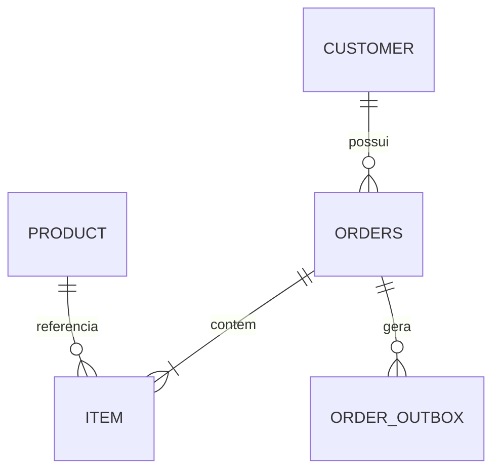

# ms-order-command

API REST de comandos de pedidos com Java 21, Spring Boot 4.2.0, PostgreSQL e Kafka.
Inclui Spring Data JPA, Bean Validation, Flyway, MapStruct 1.6.3, Swagger/OpenAPI,
Actuator, Prometheus, Maven Wrapper e testes com Testcontainers.

## Modelo de dados

As tabelas ficam no schema `order_command`. Os identificadores são UUIDs gerados pela
aplicação. Datas usam `Instant` / `TIMESTAMPTZ`; valores monetários usam `BigDecimal` /
`NUMERIC(19,2)`, sem arredondamento silencioso. Nesta versão, os preços são em BRL.

| Tabela | Campos |
| --- | --- |
| `customer` | `id`, `name` (160), `email` (254, único), `phone` (24, opcional), `active`, `created_at`, `updated_at`, `version` |
| `product` | `id`, `sku` (64, único), `name` (160), `description` (2000, opcional), `unit_price`, `active`, `created_at`, `updated_at`, `version` |
| `orders` | `id`, `customer_id`, `status` (`CREATED`, `CANCELLED`), `total_amount`, `notes` (1000, opcional), `created_at`, `updated_at`, `version` |
| `item` | `id`, `order_id`, `product_id`, `product_sku`, `product_name`, `quantity`, `unit_price` |
| `order_outbox` | `id`, `order_id`, `data_criacao`, `data_envio` (opcional), `status` (`PENDING`, `SENDED`, `ERRO`) |



`orders` evita a palavra reservada SQL `ORDER`. Cada pedido pertence a exatamente um
cliente e cada item pertence a exatamente um pedido e um produto. Não há exclusão em
cascata de histórico. Clientes/produtos referenciados não podem ser excluídos; podem
ser desativados. Pedidos são cancelados, preservando itens e histórico.

E-mails são normalizados para minúsculas e SKUs para maiúsculas antes de persistir.
Um cliente pode existir sem pedidos. Somente clientes/produtos ativos podem participar
de novos pedidos. O preço é positivo, com até duas casas decimais e máximo de
999999999.99. Cada item tem quantidade entre 1 e 10000; pedidos têm entre 1 e 1000
itens, sem produto repetido: consolide a quantidade na mesma linha.

O servidor calcula subtotais e total; o cliente envia somente produto e quantidade.
Nome, SKU e preço são copiados para o item, preservando o pedido quando o catálogo
muda. Substituir os itens cria novas linhas com os preços atuais do catálogo.
Pedidos cancelados não aceitam alteração nem novo cancelamento. O campo `version`
usa optimistic locking para detectar alterações concorrentes durante a transação.

## Migrations

- `V1__create_order_tables.sql`: tabelas, chaves estrangeiras, unicidade, checks e índices.
- `V2__enforce_order_item_invariants.sql`: valida, no commit, que cada pedido tem
  1..1000 itens e que seu total corresponde à soma dos itens. A validação é adiada
  para permitir criar o pedido e seus itens na mesma transação.

Hibernate usa `ddl-auto=validate`; Flyway executa as migrations ao iniciar.
Não é necessário apagar os volumes do Compose para aplicar essas migrations iniciais
sobre o schema vazio criado na versão anterior do serviço.

## Endpoints

Todos os caminhos abaixo usam o prefixo `/api/v1`.

| Método | Caminho | Ação |
| --- | --- | --- |
| POST / GET | `/customers` | Criar / listar clientes |
| GET / PUT / DELETE | `/customers/{id}` | Buscar / atualizar / excluir cliente sem pedidos |
| POST / GET | `/products` | Criar / listar produtos |
| GET / PUT / DELETE | `/products/{id}` | Buscar / atualizar / excluir produto sem itens |
| POST / GET | `/orders` | Criar / listar pedidos |
| GET | `/orders/{id}` | Buscar pedido com seus itens |
| POST | `/orders/{id}/cancel` | Cancelar pedido |
| GET / PUT | `/orders/{orderId}/items` | Listar / substituir todos os itens do pedido |
| GET | `/orders/{orderId}/items/{itemId}` | Buscar item dentro do pedido |
| GET | `/order-outbox` | Listar registros; filtros `orderId` e `status` |
| GET | `/order-outbox/{id}` | Buscar registro da outbox |

Listagens usam `page` (a partir de 0) e `size` (1..100, padrão 20), retornando
`content`, `page`, `size`, `totalElements` e `totalPages`, ordenados por data e UUID.
Clientes/produtos aceitam busca textual `q`; pedidos aceitam `customerId` e `status`.
Criação retorna `201` com `Location`; exclusão retorna `204`. Erros retornam Problem
Details: `400` para entradas inválidas, `404` para referências inexistentes e `409`
para duplicidade, dependências, estado incompatível e conflitos de concorrência.

Exemplos de corpos JSON:

```json
{ "name": "Maria Silva", "email": "maria@example.com", "phone": "+55 11 99999-9999" }
```

```json
{ "sku": "PROD-001", "name": "Teclado", "description": "Teclado USB", "unitPrice": 150.00 }
```

```json
{
  "customerId": "UUID_DO_CLIENTE",
  "notes": "Entregar no horário comercial",
  "items": [{ "productId": "UUID_DO_PRODUTO", "quantity": 2 }]
}
```

Para atualizar clientes/produtos, envie todos os campos obrigatórios e `active`.
Para substituir itens, envie `{ "items": [...] }` com pelo menos um item.

## Outbox

Criação, substituição de itens e cancelamento do pedido registram uma linha `PENDING`
na mesma transação. Se a outbox falhar, a alteração do pedido também é desfeita.
`data_envio` só pode ser preenchida quando o status for `SENDED`, com data igual ou
posterior a `data_criacao`; em `PENDING`/`ERRO`, permanece nula.

A API da outbox é somente de consulta. Esta entrega não inclui um dispatcher Kafka
nem sincronização com o query. A tabela contém exatamente os campos solicitados;
não armazena payload ou tipo de evento. Para publicação futura de cada versão do
pedido, será necessário definir o contrato do evento e persistir seu snapshot na outbox.

## Executar

Na raiz do repositório:

```powershell
docker compose up -d --wait kafka postgres
cd ms-order-command
.\mvnw.cmd spring-boot:run
```

No Linux/macOS, use `./mvnw`.

| Recurso | URL |
| --- | --- |
| Swagger UI | http://localhost:8080/swagger-ui.html |
| OpenAPI JSON | http://localhost:8080/v3/api-docs |
| Health | http://localhost:8080/actuator/health |
| Liveness | http://localhost:8080/actuator/health/liveness |
| Readiness (inclui PostgreSQL) | http://localhost:8080/actuator/health/readiness |
| Prometheus | http://localhost:8080/actuator/prometheus |

| Variável | Padrão |
| --- | --- |
| SERVER_PORT | 8080 |
| DB_URL | jdbc:postgresql://localhost:5432/cqrs |
| DB_USERNAME | cqrs |
| DB_PASSWORD | postgres_dev |
| DB_POOL_SIZE | 10 |
| KAFKA_BOOTSTRAP_SERVERS | localhost:9092 |
| KAFKA_CONSUMER_GROUP | ms-order-command |

Se personalizar o `.env` do Compose, ajuste as variáveis do serviço no terminal ou
na IDE; Spring Boot não carrega esse `.env` automaticamente. Dentro da rede do
Compose, use `postgres:5432` e `kafka:29092`.

Kafka permanece configurado com chaves/valores String e producer idempotente com
`acks=all`. Não existem listeners ou tópicos de negócio automáticos.
Autenticação/autorização ainda não foi definida; Swagger e Actuator estão acessíveis.

A organização usa domínio sem dependências de framework em `domain`, casos de uso
em `application`, entidades JPA/repositórios em `infrastructure/persistence` e
controllers em `interfaces/rest`. Itens são alterados pelo agregado pedido.
MapStruct converte entidades para DTOs, sem expor associações JPA na API.

## Verificação

Com Docker disponível:

```powershell
.\mvnw.cmd verify
```

Os testes usam PostgreSQL/Kafka isolados e cobrem domínio, migrations, cardinalidades,
total monetário, snapshots, erros HTTP, unicidade, referências inativas, rollback do
pedido quando a outbox falha, Swagger, health, métricas e envio/consumo Kafka.
Não utilizam os volumes do Compose.

Para gerar o JAR sem testes: `.\mvnw.cmd package -DskipTests`.
Execute com `java -jar target/ms-order-command-0.0.1-SNAPSHOT.jar`.

Referências: [MapStruct](https://mapstruct.org/documentation/stable/reference/html/),
[constraint triggers PostgreSQL](https://www.postgresql.org/docs/17/sql-createtrigger.html),
[Spring Boot](https://docs.spring.io/spring-boot/).
